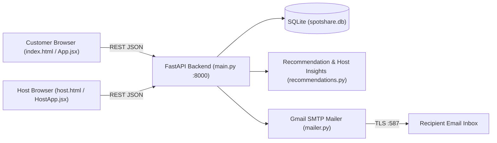

# SpotShare

**Hyperlocal Parking & EV Charging Marketplace** — find, compare, and book nearby parking spaces or EV charging stations in real time, or list and manage your own private/commercial charging bays from a dedicated Host Hub.


[](https://github.com/ashishkr-001/SpotShare_DevOps_Project/actions/workflows/ci-cd.yml)
[](https://github.com/ashishkr-001/SpotShare_DevOps_Project/actions/workflows/docker-ci.yml)
[](https://github.com/ashishkr-001/SpotShare_DevOps_Project/actions/workflows/pr-checks.yml)
[](https://spotshare-frontend-production.up.railway.app)

> **Live Deployment:** [https://spotshare-frontend-production.up.railway.app](https://spotshare-frontend-production.up.railway.app) · **API Docs:** [https://spotshare-backend-production.up.railway.app/docs](https://spotshare-backend-production.up.railway.app/docs)

---

## Table of Contents

- [Overview](#overview)
- [Features](#features)
  - [Customer Marketplace](#customer-marketplace)
  - [Host Hub](#host-hub)
  - [Authentication & Password Recovery](#authentication--password-recovery)
- [Architecture](#architecture)
- [Tech Stack](#tech-stack)
- [Project Structure](#project-structure)
- [Getting Started](#getting-started)
  - [Prerequisites](#prerequisites)
  - [Installation](#installation)
  - [Environment Configuration](#environment-configuration)
  - [Running the App](#running-the-app)
- [Application URLs](#application-urls)
- [Core Business Rules & Engine Logic](#core-business-rules--engine-logic)
- [API Reference](#api-reference)
- [Database Management](#database-management)
- [Testing & Production Build](#testing--production-build)
- [Troubleshooting](#troubleshooting)
- [DevOps, Docker & CI/CD Pipelines](#devops-docker--cicd-pipelines)
  - [Live Cloud Deployment (Railway)](#live-cloud-deployment-railway)
- [Team Collaboration & 5-Member Split](#team-collaboration--5-member-split)

---

## Overview

SpotShare connects **EV drivers and commuters** with **parking lots and private/commercial EV charger hosts**. Built around Mysuru coordinates (`12.2958, 76.6394`) with 16 pre-seeded locations, the platform supports:

- **Live slot availability** calculated per `[start, end)` time window against active reservations.
- **Interactive WebGL landing experience & map views** with OpenStreetMap + Leaflet (zero paid map API keys).
- **Host operational controls** to publish chargers, track earnings, or temporarily **Turn Off / Close** a station when out of town without losing listing data or booking history.
- **Real Gmail SMTP emails** for booking confirmations and 6-digit password reset codes.

---

## Features

### Landing Showcase & Customer Marketplace
- **Interactive WebGL Landing Page (`LandingPage.jsx`):** Features a custom GLSL dithered fluid backdrop (`ShaderBackdrop.jsx`) that morphs between **Parking** (sapphire blue) and **EV Charging** (emerald), live network telemetry (**Available Bays Now**, **Active Charger Capacity**, **Mysuru Hubs Online**, **Lowest Open Rate**), station filtering, Host Hub overview, and FAQ accordion. Clicking **Reserve Bay** routes guests to Customer Login before booking.
- **Dedicated Parking & EV Modes:** Switch seamlessly between **Parking** (blue theme) and **EV Charging** (emerald theme) with category-specific filters inside the marketplace.
- **Multi-Criteria Filtering & Sorting:**
  - Search by station name, area, or landmark.
  - Filter by **Distance** (Haversine km from Mysuru default or live browser GPS), **Price**, **Vehicle Type** (`car`, `bike`, `van`, `covered`), **Charger Type** (`AC` / `DC`), **Connector** (`Type 2`, `CCS2`, `CHAdeMO`), **Charging Power** (kW), **Owner Type** (`Public` / `Private Owners`), and **Available Now**.
  - Sort by **Nearest**, **Cheapest**, or **Top Rated**.
- **Interactive Map View:**
  - Dark-styled **OpenStreetMap** tiles via **Leaflet**.
  - Pulsing GPS user marker and color-coded price/status pins (`#6366f1` Regular, `#10b981` EV Ready, `#ef4444` Occupied, `#64748b` Closed).
  - Floating spot drawer for one-click **Book Now** and **Google Maps Directions**.
- **Booking Lifecycle & History:**
  - Dynamic cost estimate before submission, authoritative server-side pricing and conflict checking, and instant digital voucher receipt.
  - **My Bookings** view with **Active Bookings** and **Booking History** tabs, soft cancellation, and **Remove All** cleanup.
- **Favorites & Profile:** Save favorite spots and view account details in the sidebar navigation.

### Host Hub
- **Host Dashboard (`host.html` or `Host Hub Login` button):**
  - Top metric cards for **Active Chargers** (plus closed count), **Active Bookings**, **Booked Value** (`₹`), and **Available Bays**.
- **Publish New Chargers:** Add a station with name, address, GPS coordinates (**Auto-detect My Location** or manual), hourly rate (`₹/hr`), charger power (`kW`), bay capacity, supported vehicle types, and quick-pick amenities.
- **Turn Off / Close & Turn On / Reopen Stations:**
  - Temporarily pause bookings when away or out of town via **Turn Off / Close** (`PATCH /api/spots/{spot_id}/status`) instead of permanently deleting the station.
  - Closed stations keep all metadata and booking records intact, display a **Closed / Offline** status across Host and Customer views, reject new bookings (`409 spot_closed`), and are excluded from recommendations until reopened.
- **Permanent Removal:** **Remove Charger** deletes a station and its bookings after confirmation.

### Authentication & Password Recovery
- **Dark Obsidian Glass Auth Experience:** Customer Login (`App.jsx`) and Host Hub Login (`HostApp.jsx`) share the live WebGL shader backdrop with matching **AuthTopBar** switching, inline **Register an account** / **Sign in here** toggles, **Confirm Password** validation, and **Continue with Google** account selection.
- **Focus-Safe Password Toggle:** Custom [`PasswordInput`](frontend/src/components/PasswordInput.jsx) component hides browser-native reveal icons (such as Edge `::-ms-reveal`) and preserves typing cursor focus without stealing Spacebar or Tab navigation.
- **Gmail SMTP Password Reset & Booking Emails:** **Forgot password?** sends a 6-digit verification code to the user's registered email via TLS SMTP, backed by server-side SHA-256 OTP hashing, 10-minute expiration, single-use validation, and a 5-attempt lockout; confirmed bookings also send summary receipt emails when an email address is provided.

---

## Architecture



---

## Tech Stack

| Layer | Technologies |
|---|---|
| **Backend** | Python 3.10+, FastAPI (`>=0.110,<1.0`), Uvicorn (`>=0.29,<1.0`), Pydantic v2 (`>=2.6,<3.0`), SQLite (`sqlite3`), `smtplib` |
| **Frontend** | React 18, Vite 5, Leaflet (`^1.9.4`), CSS3 |
| **Testing** | `pytest` + FastAPI `TestClient` |

---

## Project Structure

```text
SpotShare_DevOps_Project/
├── .github/
│   ├── CODEOWNERS             # Automated PR review ownership across all 5 members
│   └── workflows/             # ci-cd.yml, docker-ci.yml, pr-checks.yml
├── backend/
│   ├── main.py                # FastAPI routes, CORS middleware, unified JSON error handlers
│   ├── database.py            # SQLite schema, migrations, demo seeding, concurrency & OTP logic
│   ├── models.py              # Pydantic v2 request/response schemas & validators
│   ├── mailer.py              # Brevo HTTPS API (cloud) + dynamic .env Gmail SMTP fallback
│   ├── recommendations.py     # Multi-factor spot ranking & host analytics
│   ├── test_backend.py        # pytest unit & integration test suite (11 tests)
│   ├── requirements.txt       # Python dependencies
│   ├── Dockerfile             # Production Python 3.11 FastAPI container image
│   ├── .dockerignore          # Excludes .env, *.db, caches from Docker build context
│   ├── .env.example           # Brevo HTTPS API & SMTP email configuration template
│   └── spotshare.db           # SQLite database (auto-created on first run, gitignored)
├── frontend/
│   ├── index.html             # Landing page & Customer marketplace HTML entry
│   ├── host.html              # Standalone Host Hub HTML entry
│   ├── showcase.html          # Standalone WebGL Showcase page
│   ├── vite.config.js         # Multi-page Vite build configuration
│   ├── package.json           # Frontend scripts & npm dependencies
│   ├── Dockerfile             # Multi-stage Node 20 -> Nginx Alpine image (accepts VITE_API_BASE_URL arg)
│   ├── nginx.conf             # Nginx SPA fallback routing (/parking -> index.html)
│   ├── vercel.json            # Optional Vercel SPA rewrite configuration
│   ├── .dockerignore          # Excludes node_modules, dist, .env from Docker context
│   ├── .env.example           # Frontend environment template
│   ├── public/images/spots/   # Local parking & EV spot photographs
│   └── src/
│       ├── main.jsx           # Customer React root
│       ├── host-main.jsx      # Host React root
│       ├── App.jsx            # Customer landing/auth shell, explore, map, bookings, favorites, profile
│       ├── HostApp.jsx        # Host auth, metrics, charger management, live bookings
│       ├── AddChargerForm.jsx # New EV charger creation form with GPS & validation
│       ├── api.js             # Host fetch client & field-level ApiError parser
│       ├── styles.css         # Customer & shared auth/UI styles
│       ├── HostApp.css        # Host gate & dashboard styles
│       └── components/
│           ├── AuthTopBar.jsx     # Shared top bar switching Customer Login / Host Hub / Home
│           ├── BookingModal.jsx   # Time-window booking form & digital receipt
│           ├── FilterBar.jsx      # Category-aware search, filters & sorting controls
│           ├── LandingPage.jsx    # Interactive WebGL landing page & station explorer
│           ├── LandingPage.css    # Landing page styling
│           ├── ParkingMap.jsx     # Leaflet + OpenStreetMap view with interactive drawer
│           ├── PasswordInput.jsx  # Custom show/hide password input
│           ├── ShaderBackdrop.jsx # Reusable GLSL fluid WebGL backdrop
│           ├── SpotCard.jsx       # Spot summary card with availability & directions
│           ├── SpotShareLogo.jsx  # Brand logo SVG component
│           └── SmartInsights.jsx  # Insights panel component stub
├── docker-compose.yml         # Multi-container orchestration with persistent SQLite volume
├── .dockerignore              # Root build context exclusions
├── package.json               # Workspace-level helper scripts
├── run.bat                    # Windows one-command launcher
├── run.sh                     # macOS / Linux one-command launcher
└── README.md
```

---

## Getting Started

### Prerequisites
- **Python 3.10+** (tested with Python 3.12)
- **Node.js 18+** and **npm**

### Installation

1. **Install backend dependencies:**
   ```bash
   cd backend
   pip install -r requirements.txt
   ```

2. **Install frontend dependencies:**
   ```bash
   cd frontend
   npm install
   ```

### Environment Configuration

#### 1. Backend Email Configuration (`backend/.env` or Railway Variables) — *Required for OTP & booking confirmation emails*
SpotShare uses one sender address to deliver 6-digit password-reset codes and booking confirmations to **any** customer or host email address:

- **Option A — Brevo Free HTTPS API (Recommended for Railway Free/Trial/Hobby):** Railway blocks outbound SMTP ports (`25`/`465`/`587`) unless on a Pro plan, whereas Brevo sends up to **300 emails/day free** over HTTPS (`https://api.brevo.com/v3/smtp/email`):
  1. Sign up free at `brevo.com`, verify your Gmail address as a sender (**Senders, Domains & IPs**), and create an API key (**SMTP & API → API Keys**).
  2. Set `SPOTSHARE_BREVO_API_KEY` and `SPOTSHARE_EMAIL_FROM` (e.g., `SpotShare <yourgmail@gmail.com>`) in Railway Variables or `backend/.env`.
- **Option B — Gmail SMTP (Local development or Railway Pro):**
  1. Enable **2-Step Verification** on the sender Google account and create a 16-character **App Password** at `https://myaccount.google.com/apppasswords`.
  2. Copy `backend/.env.example` to `backend/.env` and set your credentials:
     ```env
     SPOTSHARE_SMTP_HOST=smtp.gmail.com
     SPOTSHARE_SMTP_PORT=587
     SPOTSHARE_SMTP_USER=yourgmail@gmail.com
     SPOTSHARE_SMTP_PASSWORD=your_16_char_app_password
     SPOTSHARE_SMTP_FROM=SpotShare <yourgmail@gmail.com>
     ```
     > `mailer.py` reads `backend/.env` dynamically on each request and strips spaces from App Passwords automatically—no backend restart is required after saving.

#### 2. Optional Backend Variables
| Variable | Default | Description |
|---|---|---|
| `SPOTSHARE_DB_PATH` | `backend/spotshare.db` | Custom SQLite database file path |
| `SPOTSHARE_CORS_ORIGINS` | `*` | Comma-separated list of allowed CORS origins |
| `SPOTSHARE_CHECKIN_EARLY_MINUTES` | `15` | Minutes before `start_time` when simulator check-in opens |
| `SPOTSHARE_ALLOW_PAST` | `0` | Set to `1` during tests to allow past booking timestamps |

#### 3. Frontend (`frontend/.env`) — *Optional*
Defaults to `http://<hostname>:8000` locally (`http://localhost:8000`). Copy `frontend/.env.example` to `frontend/.env` to customize:
```env
VITE_API_BASE_URL=http://localhost:8000
```
When building the frontend Docker image for cloud deployment, pass `--build-arg VITE_API_BASE_URL=<backend-https-url>` so Vite bundles the production backend endpoint directly.

### Running the App

#### Option A: One-Command Launch
- **Windows:**
  ```bat
  run.bat
  ```
- **macOS / Linux:**
  ```bash
  chmod +x run.sh
  ./run.sh
  # or: npm start
  ```

#### Option B: Manual Two-Terminal Launch
- **Terminal 1 (Backend):**
  ```bash
  cd backend
  python -m uvicorn main:app --port 8000 --reload
  ```
- **Terminal 2 (Frontend):**
  ```bash
  cd frontend
  npm run dev
  ```

---

## Application URLs

| Surface | Live Production (Railway) | Local Development |
|---|---|---|
| **Landing & Customer Marketplace** | [spotshare-frontend-production.up.railway.app](https://spotshare-frontend-production.up.railway.app) | `http://localhost:5173` |
| **Parking Marketplace Route** | [spotshare-frontend-production.up.railway.app/parking](https://spotshare-frontend-production.up.railway.app/parking) | `http://localhost:5173/parking` |
| **Host Hub (Standalone)** | [spotshare-frontend-production.up.railway.app/host.html](https://spotshare-frontend-production.up.railway.app/host.html) | `http://localhost:5173/host.html` *(or **Host Hub Login** button in header)* |
| **Standalone Showcase** | [spotshare-frontend-production.up.railway.app/showcase.html](https://spotshare-frontend-production.up.railway.app/showcase.html) | `http://localhost:5173/showcase.html` |
| **Backend API** | [spotshare-backend-production.up.railway.app](https://spotshare-backend-production.up.railway.app) | `http://localhost:8000` |
| **API Docs (Swagger UI) & Health** | [`/docs`](https://spotshare-backend-production.up.railway.app/docs) · [`/api/health`](https://spotshare-backend-production.up.railway.app/api/health) | `http://localhost:8000/docs` · `/api/health` |

---

## Core Business Rules & Engine Logic

- **Timezone & Intervals:** All API timestamps use naive IST (`Asia/Kolkata`, `UTC+05:30`) in ISO 8601 format (`YYYY-MM-DDTHH:MM:SS`). Reservations use half-open intervals `[start, end)` so back-to-back bookings at the same boundary (e.g., ending at `12:00` and starting at `12:00`) never conflict.
- **Booking Constraints:**
  - Duration must be between **30 minutes** and **24 hours**.
  - Start time may be at most **5 minutes** in the past (`PAST_GRACE_MINUTES`).
  - Spot must be **open** (`is_active == True`), support the requested `vehicle_type`, offer EV charging if `requires_ev_charging=true`, and have `peak_concurrency(intervals, start, end) < capacity` inside a `BEGIN IMMEDIATE` SQLite transaction.
- **Recommendation Scoring (`recommendations.py`):** Open candidate spots with free capacity are scored from `0` to `100`:
  - **35%** Proximity (normalized Haversine distance)
  - **30%** Price competitiveness
  - **20%** Rating
  - **15%** EV charging capability
- **OTP Password Reset Security:** Codes are 6-digit random numbers (`secrets.randbelow`), stored as salted SHA-256 hashes, valid for **10 minutes**, single-use, and locked after **5 failed verification attempts**.

---

## API Reference

All errors return a uniform JSON shape:
```json
{
  "detail": "Human-readable error message",
  "code": "machine_error_code",
  "errors": [{ "field": "body.field", "message": "..." }]
}
```

### Auth & Password Reset
| Method | Endpoint | Description |
|---|---|---|
| `POST` | `/api/auth/forgot-password` | Generate a 6-digit OTP and send via Gmail SMTP (`role`: `customer` \| `host`) |
| `POST` | `/api/auth/verify-reset-code` | Verify 6-digit OTP against SQLite (`expires_in_minutes`: 10, max 5 attempts) |

### Spots & Host Station Controls
| Method | Endpoint | Description |
|---|---|---|
| `GET` | `/api/spots` | List/filter spots (`q`, `lat`, `lng`, `max_distance_km`, `min_price`, `max_price`, `ev_charging`, `vehicle_type`, `available_only`, `start_time`, `end_time`, `sort`, `owner_name`) |
| `GET` | `/api/spots/{spot_id}` | Fetch single spot details and window availability |
| `POST` | `/api/spots` | Publish a new parking or EV charging spot (`201`) |
| `PATCH` | `/api/spots/{spot_id}/status` | Temporarily close (`is_active: false`) or reopen (`is_active: true`) a station |
| `DELETE` | `/api/spots/{spot_id}` | Delete a station and its bookings |

### Bookings
| Method | Endpoint | Description |
|---|---|---|
| `GET` | `/api/bookings` | List bookings (`spot_id`, `status`, `customer_name`, `owner_name`) |
| `POST` | `/api/bookings` | Create a reservation (`201`) |
| `DELETE` | `/api/bookings/{booking_id}` | Soft-cancel a confirmed booking |
| `DELETE` | `/api/bookings/clear-all` | Permanently delete bookings (optionally filtered by `customer_name`) |

### Recommendations, Insights, Health & Simulator
| Method | Endpoint | Description |
|---|---|---|
| `GET` | `/api/recommendations` | Ranked open spots matching user preferences (`limit` 1–20) |
| `GET` | `/api/insights` | Live platform-wide summary (`total_spots`, `active_spots`, `available_spaces`) & booking stats |
| `GET` | `/api/host/insights` | Per-host revenue, bay availability, occupancy %, and insights (`owner_name`) |
| `GET` | `/api/health` | Backend service, database, and server time check |
| `POST` | `/api/simulator/check-in` | Software-only simulated barrier check-in (`booking_id`) |
| `POST` | `/api/simulator/reset` | Reset simulated check-ins back to `confirmed` |

---

## Database Management

On startup, `database.init_db()` creates tables (`spots`, `bookings`, `password_resets`), runs safe column migrations, and seeds **16 demo spots** (`spot101`–`spot108` parking lots, `spot201`–`spot208` EV chargers) plus **4 sample bookings** if `spots` is empty.

```bash
cd backend
python database.py init    # Ensure schema/migrations & seed if empty
python database.py reset   # Wipe spots & bookings and re-seed demo data
```

---

## Testing & Production Build

### Backend Test Suite (`pytest`)
Covers health checks, spot listing/creation/deletion, booking capacity & validation, recommendations, simulator check-in/reset, station close/reopen lifecycle, and OTP email/verification flows:
```bash
cd backend
python -m pytest test_backend.py -v
```
*(Or from project root on Unix/Git Bash: `npm run test:backend`)*

### Frontend Production Build
Builds `index.html`, `host.html`, and `showcase.html` bundles into `frontend/dist/`:
```bash
cd frontend
npm run build
```
*(Or from project root: `npm run build:frontend`)*

---

## Troubleshooting

| Issue | Fix |
|---|---|
| **`503 Email service is not configured yet`** | On Railway Free/Trial/Hobby, set `SPOTSHARE_BREVO_API_KEY` and `SPOTSHARE_EMAIL_FROM` in **`spotshare-backend` → Variables**. Locally, create `backend/.env` from `backend/.env.example` with your Gmail `SPOTSHARE_SMTP_USER` and `SPOTSHARE_SMTP_PASSWORD`. |
| **`502` Email auth failed** | For Brevo (`SPOTSHARE_BREVO_API_KEY`), confirm your v3 API key and verified sender email. For Gmail SMTP, ensure 2-Step Verification is enabled and use a 16-character **App Password** (not your normal Gmail login password). |
| **Forgot password says `No account found`** | Customer and host profiles are stored in browser `localStorage` (`spotshare_registered_users` / `spotshare_registered_hosts`); make sure you are testing with an email registered in that browser. |
| **Frontend shows `Cannot reach the server`** | Confirm the FastAPI backend is running on port `8000` (`http://localhost:8000/api/health`). |
| **Note on Simulator & Auth Storage** | The check-in barrier simulator is software-only (no hardware integration). User/host login profiles persist in browser `localStorage`, while listings, bookings, analytics, and password-reset OTPs persist in SQLite. |

---

## DevOps, Docker & CI/CD Pipelines

### GitHub Actions Workflows (`.github/workflows/`)
1. **`ci-cd.yml` (`SpotShare CI/CD Pipeline`)** — Runs on pushes to `main` & feature branches (`feat/**`, `ci/**`, `fix/**`, `member-*`) and Pull Requests:
   - `backend-ci`: Python bytecode check, SQLite `init`/`reset` smoke test, and full `pytest test_backend.py -v` suite.
   - `frontend-ci`: `npm ci`, Vite multi-page build (`index.html`, `host.html`, `showcase.html`), and `frontend-dist` artifact upload.
   - `integration-smoke-test`: Boots live `uvicorn` server and checks `/api/health`, `/api/spots`, `/api/recommendations`, `/api/insights`, and `/docs`.
   - `cd-deploy`: Deploys built frontend bundle to GitHub Pages on merge to `main`.
2. **`docker-ci.yml` (`Docker Build & Container Health CI`)** — Validates `docker-compose.yml`, builds `backend/Dockerfile` & `frontend/Dockerfile`, and smoke-tests live running containers.
3. **`pr-checks.yml` (`PR Quality & Security Hygiene Checks`)** — Verifies no `.env`, `*.db`, or `node_modules/` are tracked, runs `pip check`, `compileall`, and `npm audit`.

### Live Cloud Deployment (Railway)

SpotShare is deployed live on **Railway** (`production` environment) as two container services:

| Service | Public URL | Image & Port | Configuration |
|---|---|---|---|
| **`spotshare-backend`** | [spotshare-backend-production.up.railway.app](https://spotshare-backend-production.up.railway.app) | `ashishkr001/spotshare-backend:latest` (Port `8000`) | Persistent volume `spotshare-db-data` mounted at `/app/data` (`SPOTSHARE_DB_PATH=/app/data/spotshare.db`), `SPOTSHARE_CORS_ORIGINS=*`, healthcheck `/api/health` |
| **`spotshare-frontend`** | [spotshare-frontend-production.up.railway.app](https://spotshare-frontend-production.up.railway.app) | `ashishkr001/spotshare-frontend:railway` (Nginx Port `80`) | Built with `--build-arg VITE_API_BASE_URL=https://spotshare-backend-production.up.railway.app`, healthcheck `/` |

> **Live Email Setup on Railway Free / Trial / Hobby Plans:** Railway disables outbound SMTP ports unless on a Pro plan, so `spotshare-backend` uses **Brevo's HTTPS API** (free 300 emails/day). Add `SPOTSHARE_BREVO_API_KEY` and `SPOTSHARE_EMAIL_FROM` (your Brevo-verified Gmail sender) under **`spotshare-backend` → Variables** in the Railway Dashboard to enable both booking confirmation emails and 6-digit password-reset codes.

### Run with Docker Compose or Pre-Built Docker Hub Images

**Build & run locally with Docker Compose:**
```bash
docker compose up --build -d
```
- **Frontend:** `http://localhost:5173`
- **Backend API & Docs:** `http://localhost:8000/docs`

**Pull pre-built images from Docker Hub (`ashishkr001`):**
- Backend: [`ashishkr001/spotshare-backend`](https://hub.docker.com/r/ashishkr001/spotshare-backend) (`latest`, `1.2`, `1.1`)
- Frontend: [`ashishkr001/spotshare-frontend`](https://hub.docker.com/r/ashishkr001/spotshare-frontend) (`latest`, `1.2` for local `http://<host>:8000`; `railway` for the hosted Railway backend)

```bash
docker pull ashishkr001/spotshare-backend:latest
docker pull ashishkr001/spotshare-frontend:latest
docker volume create spotshare_sqlite_data
docker run -d --name spotshare-backend -p 8000:8000 -v spotshare_sqlite_data:/app/data ashishkr001/spotshare-backend:latest
docker run -d --name spotshare-frontend -p 80:80 ashishkr001/spotshare-frontend:latest
```

---

## Team Collaboration & 5-Member Split

See [.github/CODEOWNERS](.github/CODEOWNERS) for automated PR review routing across all 5 members:

| Member | GitHub Username | Module Ownership | Feature Branch |
|---|---|---|---|
| **Member 1** | [`@aryan-tengale`](https://github.com/aryan-tengale) | Backend API, Pydantic Models & SMTP Mailer (`main.py`, `models.py`, `mailer.py`) | `feat/api-auth-mailer` |
| **Member 2** | [`@aryanrajcodes`](https://github.com/aryanrajcodes) | SQLite Data Layer & Recommendation Engine (`database.py`, `recommendations.py`) | `feat/db-recommendations` |
| **Member 3** | [`@ashishkr-001`](https://github.com/ashishkr-001) | Customer Marketplace UI, Landing Shader, Map & Showcase (`App.jsx`, `LandingPage.jsx`, `ParkingMap.jsx`, `BookingModal.jsx`, `FilterBar.jsx`) | `feat/customer-marketplace` |
| **Member 4** | [`@arvetivijvalarya`](https://github.com/arvetivijvalarya) | Host Hub, Station Controls & Insights (`HostApp.jsx`, `AddChargerForm.jsx`, `AuthTopBar.jsx`, `SmartInsights.jsx`, `PasswordInput.jsx`) | `feat/host-hub-controls` |
| **Member 5** | [`@singhanurag0735-gif`](https://github.com/singhanurag0735-gif) | DevOps, Docker, CI/CD Pipelines, Pytest Suite & Docs (`.github/`, `Dockerfile`s, `test_backend.py`, `README.md`) | `ci/github-actions-pipeline` |

